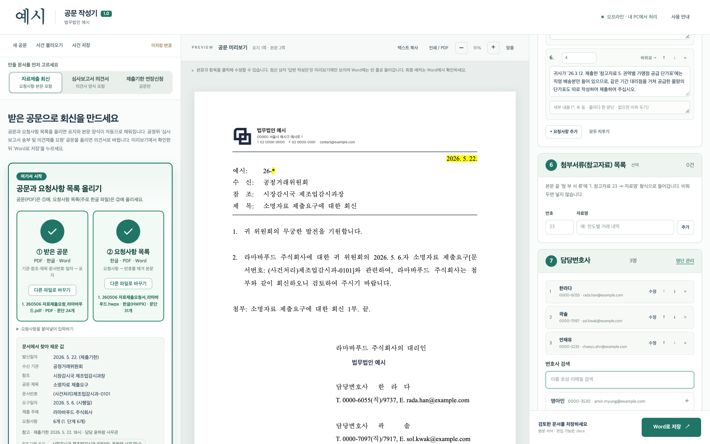
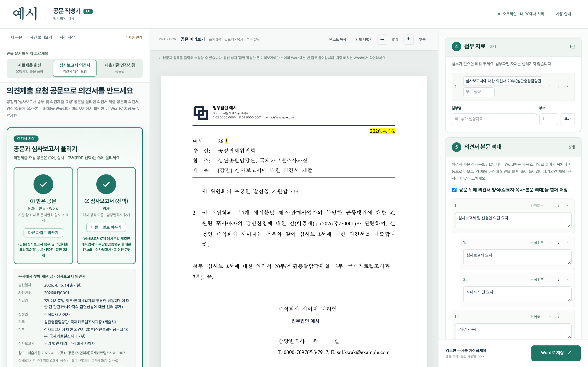
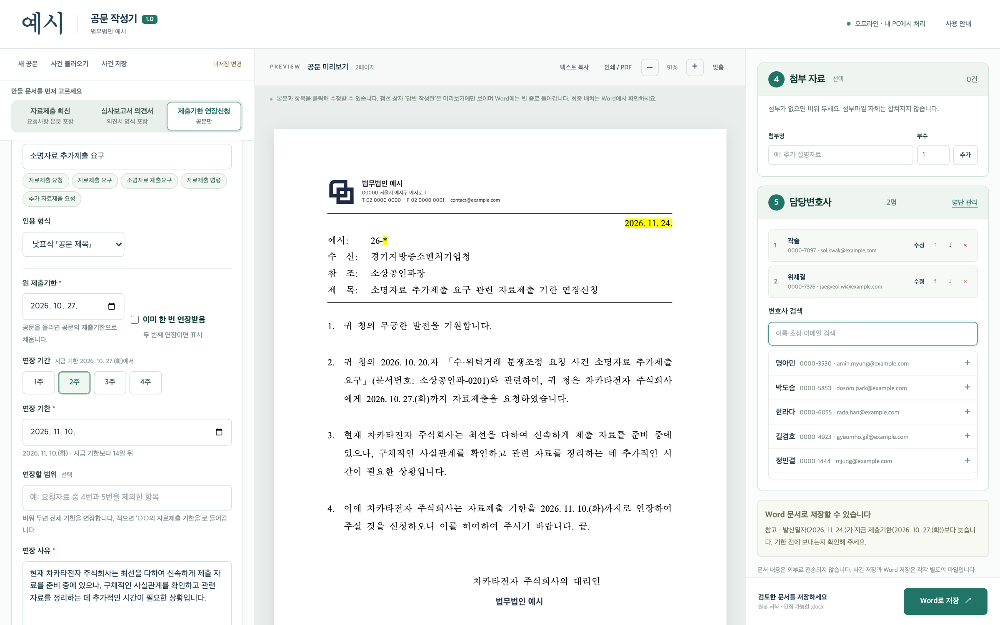
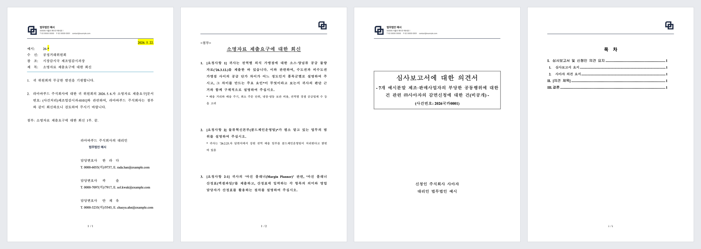
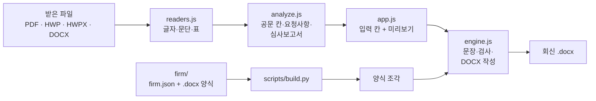

# Gongmun Writer (공문 작성기)

규제기관에서 받은 공문으로 로펌의 회신 공문을 만드는 오프라인 브라우저 프로그램이다. 받은 공문(PDF·한글·HWPX·Word)과 요청사항 목록을 올리면 발신 기관, 문서번호, 날짜, 제출기한, 번호 붙은 요청사항을 찾아, 로펌의 레터헤드와 서식 그대로 Word 회신 파일을 만든다.

HTML 파일 하나다. 설치가 필요 없고 파일은 컴퓨터 밖으로 나가지 않는다.

**데모:** [hyeokyun-kr.github.io/gongmun-writer/dist/gongmun-writer.html](https://hyeokyun-kr.github.io/gongmun-writer/dist/gongmun-writer.html) — 브라우저에서 바로 쓴다. 시험용 가짜 공문은 [`tests/fixtures/`](tests/fixtures)에 있다.

상태: 1.0으로 실제 사용 중. 이 공개판은 로펌, 변호사, 모든 사건 문서를 가짜로 바꿨다(「법무법인 예시」, 가짜 이름, `example.com` 메일).

English: [README.md](README.md)



## 목적

공정거래위원회 등에 내는 회신 공문은 형식이 정해져 있다. 상대 공문을 날짜와 문서번호로 인용하는 표지, 요청사항을 하나씩 다시 적고 그 아래 답을 쓰게 하는 첨부 본문, 담당변호사 서명부다. 요청이 올 때마다 PDF와 한글 파일에서 이것을 손으로 옮겨 적었다. 이 프로그램은 파일에서 그 초안을 만들고, 내용은 변호사가 쓴다.

## 기능

| 문서 | 넣는 것 | 나오는 것 |
| --- | --- | --- |
| 자료제출 회신 | 받은 공문과 요청사항 목록 | 표지 + 요청사항마다 번호 제목·세부 내용·답변 자리가 있는 첨부 본문 |
| 심사보고서 의견서 | 심사보고서 송부 공문(심사보고서는 선택) | 표지, 겉표지, 목차, 의견서 뼈대. 심사보고서에서 우리 법인이 대리하는 피심인과 담당변호사를 찾음 |
| 제출기한 연장신청 | 원래 요청 공문 | 원 기한·연장 기한·사유를 넣은 표지(로펌 표준 문장) |

- **한글 공공 문서를 브라우저에서 읽음:** HWP 5.0(OLE 복합 파일·압축 레코드), HWPX, DOCX, 글자 PDF(pdf.js·한국어 CMap), 붙여넣은 글.
- **공문에서 찾는 것:** 발신 기관, 수신 회사, 제목, 문서번호, 시행일, 제출기한(세 가지 표기), 사건번호·사건명(두 줄로 나뉘거나 `*****`로 가린 것 포함), 참조 부서·담당자, 제출 부수.
- **요청사항 찾기:** `[요청사항 2-1]`, `1.`/`가.`, Word·한글 자동 번호, 표 형식 목록. 세부 내용(`*`, `※`)은 해당 요청에 붙이고 양식 표는 뺀다.
- **로펌 서식 그대로 Word 작성:** 표지와 본문을 로펌의 .docx 양식에서 만들어 글꼴·간격·머리글·번호가 같다. 미리보기는 Word의 간격·쪽 나눔을 따른다(비교한 문서 5건 모두 쪽수가 Word와 같음).
- **기존 Word 회신 편집:** Word에서 이미 고친 회신에 변호사를 더하거나 빼거나 순서를 바꾸고, 나머지는 바이트까지 그대로 둔다.
- **사건 저장:** 사건 파일(JSON)로 직접 고친 내용까지 되살린다.





Word 출력(Microsoft Word로 열어 내보냄): 회신 표지, 요청사항 본문, 의견서 겉표지, 목차.



## 동작 방식



1. `scripts/build.py`가 로펌의 Word 양식 두 개를 조각(표 행, 문단, 구역, 머리글, 번호, 설정)으로 나눈다. 이 조각과 로펌 설정, pdf.js, 프로그램 코드를 HTML 하나(`dist/gongmun-writer.html`)에 넣는다.
2. `readers.js`가 파일 형식을 직접 읽는다. HWP 스트림은 마지막 DEFLATE 블록 뒤에 8바이트가 더 있어 브라우저 내장 해제기가 거부하므로, 자체 DEFLATE 해제기를 쓴다.
3. `analyze.js`는 AI가 아니라 규칙으로 칸을 찾는다. 찾은 값은 모두 사용자가 보고 고칠 수 있는 후보다.
4. `engine.js`가 문장(이름·숫자 뒤 조사 포함)을 쓰고 양식 조각을 채워 .docx를 만든다.

페이지 보안 정책(CSP)이 모든 네트워크 접근을 막는다. 시험에서도 요청이 하나도 없는지 확인한다.

## 시작하기

`dist/gongmun-writer.html`을 Chrome이나 Edge로 열거나 [데모](https://hyeokyun-kr.github.io/gongmun-writer/dist/gongmun-writer.html)를 쓴다. 시험해 볼 공문은 `tests/fixtures/`(requests, opinion, extension)에 있다(모두 가짜).

소스나 로펌 설정을 바꾼 뒤 다시 만들기:

```sh
python3 scripts/build.py        # 파이썬 표준 라이브러리만 사용 → dist/gongmun-writer.html
```

## 다른 로펌에서 쓰기

로펌마다 다른 것은 모두 `firm/`에 있다.

| 파일 | 내용 |
| --- | --- |
| `firm/firm.json` | 로펌 이름, 관리번호 앞 표기, 심사보고서에서 찾을 이름, 변호사 명단(이름·직통·비서·메일) |
| `firm/templates/reply.docx` | 레터헤드가 든 회신 표지. 본문·겉표지·목차도 이 서식을 쓴다 |
| `firm/templates/additional.docx` | 추가 설명자료 제출 표지 |
| `firm/images/` | 양식과 미리보기에 쓰는 레터헤드 그림 |

자기 로펌 것으로 바꾸고 `scripts/build.py`를 돌린다. 양식에는 빌드가 찾는 기준 글자(수신 표, `관련하여`가 든 문단, `첨부`, `의 대리인`, `담당변호사`, `T.`)가 남아 있어야 한다.

## 검증

```sh
npm install playwright-core@1.47 pdfjs-dist@3.11.174
zsh scripts/run_tests.sh node_modules/playwright-core node_modules/pdfjs-dist/legacy/build/pdf.js
```

| 시험 | 검사 수 | 내용 |
| --- | --- | --- |
| engine, engine-v3, opinion | 15 · 11 · 6 | 문장, 조사, 입력 검사, DOCX 구성, 사건 파일 |
| readers | 9 | HWP·HWPX·DOCX·PDF 읽기, 자체 DEFLATE 해제기를 zlib과 362개 스트림에서 대조, 공문·요청사항 분석 |
| v3-flow, v3-ui | 3건 · 7 | 올리기 → 칸 채우기 → Word, 편집, 휴대폰 폭 |
| opinion-flow, extension-flow | 7 · 11 | 나머지 두 문서 처음부터 끝까지 |
| tab-switch, file-switch | 19 · 32 | 문서 종류를 바꾸거나 파일을 갈아 올릴 때 남길 값과 지울 값 |
| v3-word-amend, word-import, word-zip | 9 · 12 · 5 | 기존 Word 파일의 변호사 편집, 나머지는 바이트까지 그대로 |
| browser, optional-fields, preview-contacts | 15 · 3 · 10 | 화면 전체, 네트워크 요청 없음, 페이지 오류 없음 |
| `verify_docx.py`, `verify_imported_docx.py` | 만든 파일 전부 | ZIP, XML, 관계, 그림, 구역, 스타일, 번호 정의 |

시험 공문은 가짜지만 규칙이 기대는 실제 공문의 특징을 그대로 살렸다. 번호 체계, 세부 내용, 양식 표, 두 줄 사건명, 쪽이 넘어가며 각주가 끼는 피심인 목록, 줄 끝에서 끊긴 전화번호, 한 공문에 피심인 여러 곳 등이다. HWP 파일은 한글로 저장한 것이다.

개발 중에는 공개하지 않는 실제 공문으로도 규칙을 확인했다. 요청사항 세트 3건의 칸 119개(오류 0), 심사보고서 송부 공문 64항목(오류 4건 찾아 고침), 연장신청 56값(오류 0)이며, 각각 코드를 쓰지 않은 검토자가 대조했다. 만든 파일은 macOS의 Microsoft Word로 내보내 확인했다.

## 한계

- 스캔 PDF는 읽을 글자가 없다. 값을 직접 넣거나 붙여 넣는다.
- 암호·복사 방지가 걸린 한글 파일은 읽지 못한다.
- PDF에서 낱말 중간에 줄이 바뀐 곳은 띄어쓰기를 추정한다. PDF에서 읽은 요청 문장은 한 번 읽어 본다.
- 값은 공문에 적힌 그대로다. 받은 공문의 오타나 번호 오류도 그대로 들어간다.
- 미리보기 쪽 나눔은 비교한 경우 Word와 같았지만, 최종 배치는 Word에서 확인한다.
- 규칙은 지금까지 본 공문 형식(공정위, 지방중소벤처기업청)을 다룬다. 다른 기관은 규칙이 더 필요할 수 있다.

## 변경 이력

### 2026-11-24
- 공개판: 로펌 설정을 `firm/`으로 분리, 가짜 로펌·변호사·시험 문서, 영문·국문 README.

### 2026-11 (1.0)
- 사용자 배포 첫 판. 제출기한 연장신청, 문서 종류 탭, 따옴표·띄어쓰기를 로펌 Word 양식에 맞춤.

### 2026-10
- 심사보고서 의견서, 올린 파일 바꾸기, 3단 화면.
- 요청사항 첨부 본문, HWP·HWPX·PDF 읽기, 기존 Word 회신 편집.

## 파일 구성

```
src/
  index.html, styles.css  화면
  readers.js              HWP·HWPX·DOCX·PDF·텍스트 읽기, DEFLATE 해제기
  analyze.js              공문·요청사항·심사보고서 규칙
  engine.js               문장, 입력 검사, DOCX 작성, 사건 파일
  word-import.js          기존 Word 파일의 변호사 편집
  app.js                  입력 칸, 미리보기, 탭, 올리기
firm/                     로펌 설정, 양식, 레터헤드 그림
scripts/build.py          dist/gongmun-writer.html 만들기
scripts/verify_*.py       만든 Word 파일 구조 점검
tests/                    Node·Playwright 시험, tests/fixtures/에 가짜 공문
vendor/pdfjs-3.11.174/    Mozilla pdf.js(Apache-2.0)와 한국어 CMap
dist/gongmun-writer.html  만든 프로그램
docs/USER_GUIDE.md        사용 안내
```

## 라이선스

코드: [MIT](LICENSE). pdf.js: Apache-2.0(`vendor/pdfjs-3.11.174/LICENSE`). `firm/`과 `tests/fixtures/`의 이름·번호·문서는 모두 가짜다.
