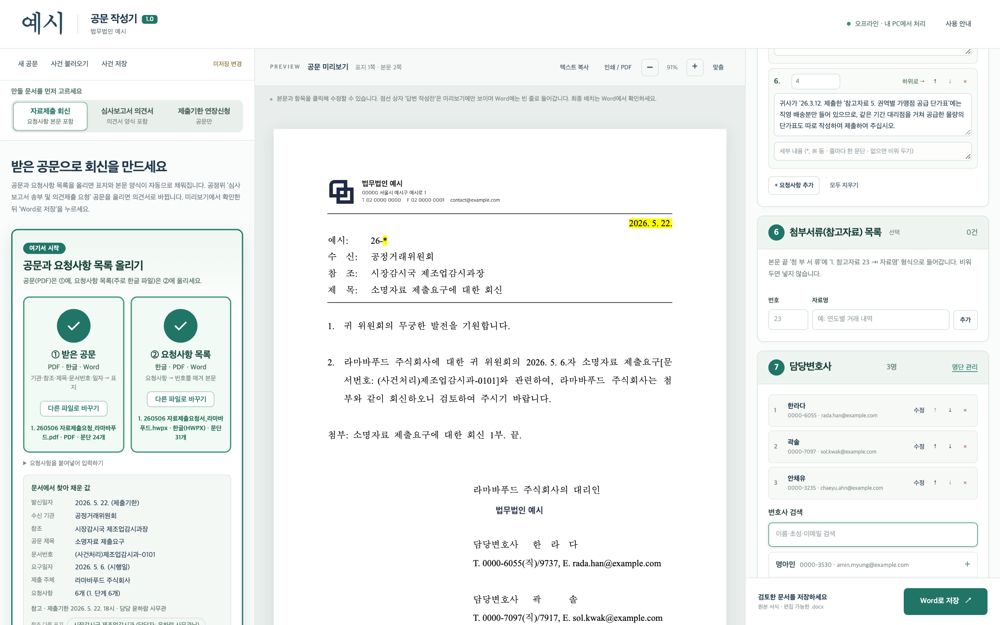
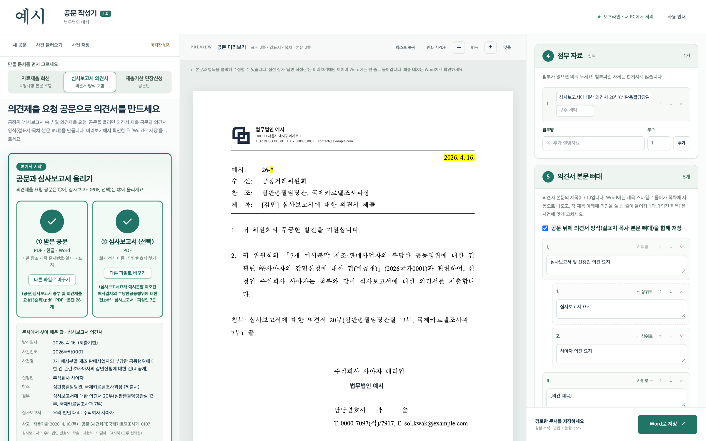
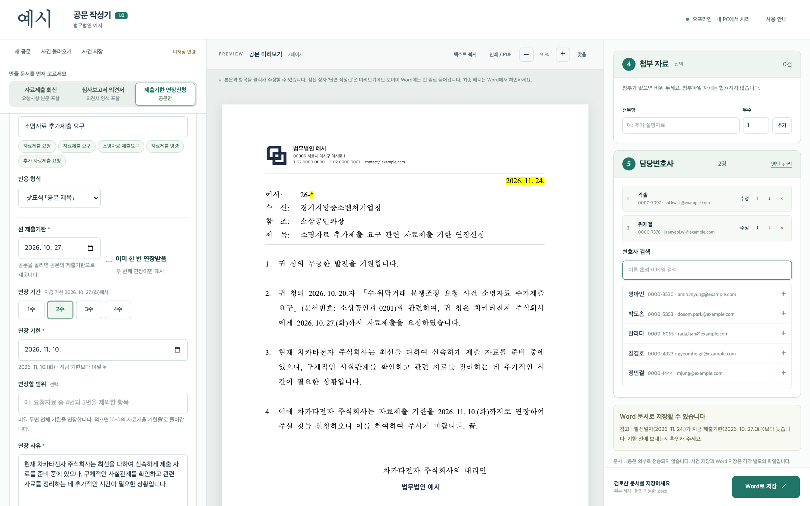
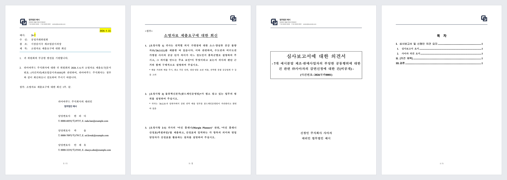
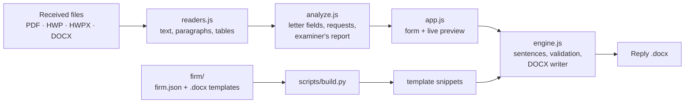

# Gongmun Writer

An offline browser app that turns a letter received from a Korean regulator into a law firm's reply. Drop in the regulator's letter (PDF, HWP, HWPX or Word) and its list of requests; the app reads the sender, reference numbers, dates, deadline and every numbered request, and writes the reply as a Word file in the firm's own letterhead and layout.

It is one HTML file. Nothing is installed and no file leaves the computer.

**Demo:** [hyeokyun-kr.github.io/gongmun-writer/dist/gongmun-writer.html](https://hyeokyun-kr.github.io/gongmun-writer/dist/gongmun-writer.html) — runs in the browser; try it with the fictitious letters in [`tests/fixtures/`](tests/fixtures).

Status: in use as version 1.0. This public copy replaces the firm, its lawyers and every case document with fictitious ones (「법무법인 예시」, fake names, `example.com` addresses).

한국어: [README.ko.md](README.ko.md)



## Purpose

Replies to the Korea Fair Trade Commission and similar agencies follow a fixed form: a cover letter that cites the agency's letter by date and document number, a numbered body that repeats each request so the client can answer under it, and a signature block listing the lawyers. Lawyers and staff used to retype all of it from PDFs and Hangul files for every request. The app does that first draft from the files and leaves the substance to the lawyers.

## Features

| Document | Input | Output |
| --- | --- | --- |
| Reply to a data request (자료제출 회신) | The agency's letter and its request list | Cover letter and an attached body with every request as a numbered heading, notes under it, and space for the answer |
| Opinion on an examiner's report (심사보고서 의견서) | The letter sending the report, optionally the report itself | Cover letter, title page, table of contents and an outline of the opinion; from the report it finds the respondent the firm represents and its lawyers |
| Deadline extension request (제출기한 연장신청) | The original request letter | Cover letter with the original deadline, new deadline and reason, in the firm's standard wording |

- **Reads Korean government files in the browser:** HWP 5.0 (OLE container, compressed records), HWPX, DOCX, text PDFs (pdf.js with Korean CMaps) and pasted text.
- **Finds the parts of a letter:** sender agency, recipient company, title, document number, date, deadline (three ways of writing it), case number and name (including names split over two lines or masked as `*****`), referenced department and contact, number of copies.
- **Finds the requests:** numbering schemes such as `[요청사항 2-1]`, `1.`/`가.`, Word and Hangul automatic numbering, request tables; keeps notes (`*`, `※`) with their request and leaves form tables out.
- **Writes Word in the firm's format:** cover and body are built from the firm's own .docx template, so fonts, spacing, headers and numbering match what the lawyers use. The preview follows Word's spacing and page breaks (same page count as Word in 5 of 5 compared documents).
- **Edits existing Word replies:** adds, removes or reorders lawyers on a reply that was already edited in Word, leaving the rest of the file byte-identical.
- **Saves cases:** a case file (JSON) restores everything, including manual edits.





Word output (opened and exported by Microsoft Word): reply cover, request body, opinion title page, table of contents.



## How it works



1. `scripts/build.py` reads the firm's two Word templates and cuts them into snippets (table rows, paragraphs, sections, headers, numbering, settings). It inlines them, the firm profile, pdf.js and the app code into one HTML file, `dist/gongmun-writer.html`.
2. `readers.js` parses each file type itself. HWP streams carry eight extra bytes after the last DEFLATE block, which the browser's decompressor rejects, so the app has its own DEFLATE decoder.
3. `analyze.js` applies rules, not AI, to find each field. Every value is shown as a candidate the user can correct.
4. `engine.js` writes the sentences (including Korean particles after names and numbers) and fills the template snippets into a .docx.

The page's Content Security Policy blocks all network access; the tests check that no request is made.

## Getting started

Open `dist/gongmun-writer.html` in Chrome or Edge, or use the [demo](https://hyeokyun-kr.github.io/gongmun-writer/dist/gongmun-writer.html). To try it, use the fictitious letters in `tests/fixtures/` (requests, opinion, extension).

To rebuild after changing the source or the firm profile:

```sh
python3 scripts/build.py        # Python 3 standard library only → dist/gongmun-writer.html
```

## Using it for another firm

Everything firm-specific is in `firm/`:

| File | Contents |
| --- | --- |
| `firm/firm.json` | Firm name, the label before the management number, the name to look for in examiner's reports, lawyer list (name, direct line, assistant line, email) |
| `firm/templates/reply.docx` | Reply cover in the firm's letterhead; its styles are also used for the body, title page and contents |
| `firm/templates/additional.docx` | Cover for additional submissions |
| `firm/images/` | Letterhead images used in the templates and the preview |

Replace these with the firm's own and run `scripts/build.py`. The templates must keep the anchor texts the build looks for (the recipient table, a paragraph containing `관련하여`, `첨부`, `의 대리인`, `담당변호사`, `T.`).

## Verification

```sh
npm install playwright-core@1.47 pdfjs-dist@3.11.174
zsh scripts/run_tests.sh node_modules/playwright-core node_modules/pdfjs-dist/legacy/build/pdf.js
```

| Test | Checks | What it covers |
| --- | --- | --- |
| engine, engine-v3, opinion | 15 · 11 · 6 | Sentences, particles, validation, DOCX parts, case files |
| readers | 9 | HWP/HWPX/DOCX/PDF reading, own DEFLATE decoder against zlib on 362 streams, letter and request analysis |
| v3-flow, v3-ui | 3 cases · 7 | Upload → filled form → Word, editing, mobile layout |
| opinion-flow, extension-flow | 7 · 11 | The two other document types end to end |
| tab-switch, file-switch | 19 · 32 | Switching document type and replacing files keeps or resets the right values |
| v3-word-amend, word-import, word-zip | 9 · 12 · 5 | Editing lawyers in existing Word files; everything else stays byte-identical |
| browser, optional-fields, preview-contacts | 15 · 3 · 10 | Whole-app checks, no network requests, no page errors |
| `verify_docx.py`, `verify_imported_docx.py` | all outputs | ZIP, XML, relationships, images, sections, styles and numbering of every generated file |

The test letters are fictitious but reproduce the features of real ones that the rules depend on: numbering schemes, notes, form tables, two-line case names, a respondent list broken across pages with footnotes, phone numbers split at line ends, several respondents in one letter. The HWP file was saved by Hangul.

During development the rules were also checked against real letters, which are not published: 119 fields across three request sets (0 errors), 64 items on examiner's report letters (4 errors found and fixed) and 56 values on extension requests (0 errors), each by a reviewer that did not write the code. Generated files were checked by exporting them from Microsoft Word on macOS.

## Limitations

- Scanned PDFs have no text to read; values must be typed or pasted.
- Password-protected or copy-protected Hangul files cannot be read.
- Where a PDF line breaks inside a word, the app guesses whether there was a space; request text from PDFs should be read once.
- Values are taken as written: typos and numbering errors in the received letter are kept.
- The preview matches Word's page breaks in the tested cases; final layout should still be checked in Word.
- The rules cover the letter formats seen so far (KFTC, SME agencies); other agencies may need new rules.

## Changelog

### 2026-11-24
- Public version: firm profile moved to `firm/`, fictitious firm, lawyers and test documents, English and Korean README.

### 2026-11 (1.0)
- First release to users. Deadline extension requests, document-type tabs, quotation marks and spacing matched to the firm's Word template.

### 2026-10
- Opinion on an examiner's report; replacing uploaded files; three-column layout.
- Attached body with numbered requests; HWP/HWPX/PDF reading; editing existing Word replies.

## Files

```
src/
  index.html, styles.css  page and layout
  readers.js              HWP, HWPX, DOCX, PDF, text readers; DEFLATE decoder
  analyze.js              letter, request list and examiner's report rules
  engine.js               sentences, validation, DOCX writer, case files
  word-import.js          editing lawyers in existing Word files
  app.js                  form, preview, tabs, uploads
firm/                     firm profile, templates, letterhead images
scripts/build.py          builds dist/gongmun-writer.html
scripts/verify_*.py       structural checks of generated Word files
tests/                    Node and Playwright tests; tests/fixtures/ holds the fictitious letters
vendor/pdfjs-3.11.174/    Mozilla pdf.js (Apache-2.0) with Korean CMaps
dist/gongmun-writer.html  built app
docs/USER_GUIDE.md        user guide (Korean)
```

## License

Code: [MIT](LICENSE). pdf.js: Apache-2.0 (`vendor/pdfjs-3.11.174/LICENSE`). All names, numbers and documents in `firm/` and `tests/fixtures/` are fictitious.
